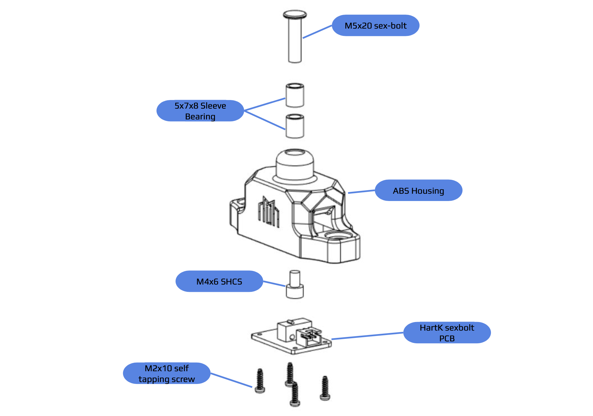
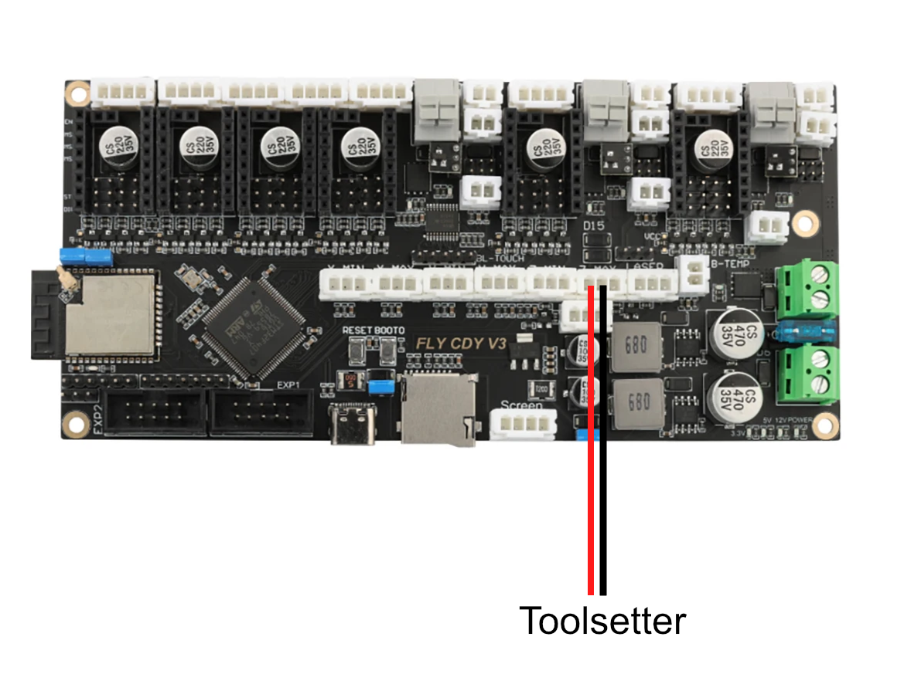

# Long John Assembly Manual

## Mechanical Assembly

!!! info annotate "Threadlocker"
    These machines vibrate intensely when running and fasteners are bound to back out. Don’t be afraid to add a little bit of medium-strength threadlocker to your central screw to avoid this problem. Threadlocker should **not** be used on the self-tapping screws as the chemicals in threadlocker may damage the ABS and cause it to weaken.

{: .shadow}

## Electronics Assembly

!!! info annotate "Are you building an LDO kit?"
    LDO has written a fantastic supplementary guide for the wiring included with their kit, which is pre-cut, pre-crimped, and pre-soldered! If you're building an LDO kit then check out their guide [here!](https://ldomotion.com/guides/milo-cnc-v15-wiring-guide)

Plug the toolsetter into the `Z_MAX` endstop connector. Note that your wire colours may be different than those shown in the images.

{: .shadow}
