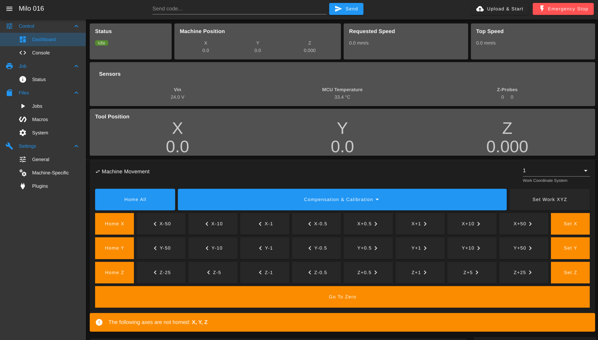
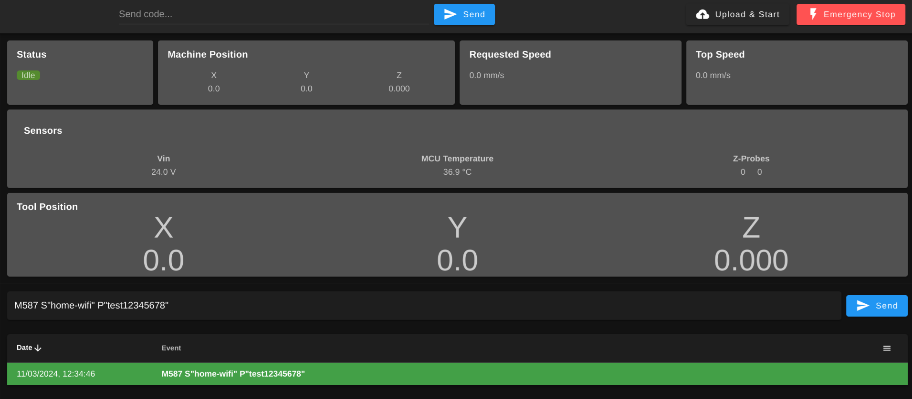
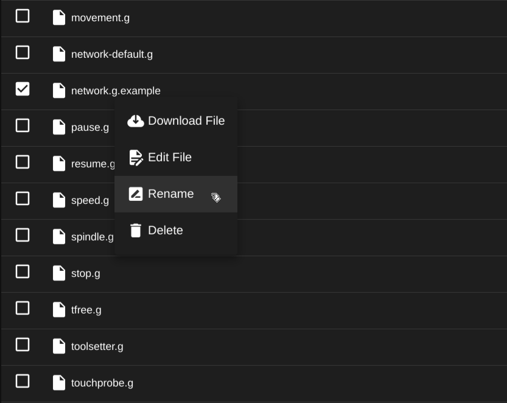

# Installing RRF

*[RRF]: RepRapFirmware
*[DWC]: Duet Web Control
*[UEB]: Universal Electronics Box

This page is for Milo 2.0 and Miley 2.0 builds with a BTT Scylla V1.0 mainboard. It works whether your electronics are in the [Universal Electronics Box](../ueb/index.md) (UEB) or in the electronics bay of a [Casa](../casa/index.md) or [Casita (beta)](https://www.printables.com/model/1829378-casita-the-miley-enclosure-beta) enclosure. It assumes the Scylla is wired as in the [UEB wiring reference (PDF)](https://github.com/MillenniumMachines/Universal-Electronics-Box/blob/main/Millennium%20Universal%20CNC%20wiring%20.pdf).

It takes you from a blank SD card to:

- RepRapFirmware (RRF) installed on the Scylla
- Duet Web Control (DWC), the machine's web interface, on your WiFi network
- the Milo 2.0 or Miley 2.0 configuration
- the emergency stop, touch probe and toolsetter set up
- endstops, homing and travel limits checked before first use

!!! warning "Prerelease for testing"
    The Milo 2.0 and Miley 2.0 configurations are a prerelease for testing, and not yet tested on every machine. If something doesn't work, or you have a suggestion, open an issue in [RRF-Configs](https://github.com/MillenniumMachines/RRF-Configs/issues).

!!! note "Public Beta"
    The RRF configurations are released as a public beta. As outlined in the repository, we take no responsibility or liability for any loss or damage caused to you or others from the use of this software, which is provided as-is.

!!! info "Coming next: nxt"
    This page sets up MillenniumOS 0.5.x, the current release. Its successor, **nxt** ([MOS-nxt](https://github.com/MillenniumMachines/MOS-nxt)), is in development and not released yet. nxt needs RRF 3.7. This page installs RRF 3.6.1, so moving to nxt later will include a firmware upgrade.

---

## Prepare your SD card

You need a freshly formatted SD card of up to 32GB, class 4 or higher.

- 4GB or smaller: format it as FAT16.
- Larger than 4GB (up to 32GB): format it as FAT32.

---

## Download the configuration release

Open the [`v15.11.26-prerelease`](https://github.com/MillenniumMachines/RRF-Configs/releases/tag/v15.11.26-prerelease) release of RRF-Configs. Under **Assets**, download the Scylla zip that matches your machine and your motor power supply:

- Milo 2.0:
    - 24V: `rrf-milo-v2.0-milo-scylla-v1.0-24v-v15.11.26-prerelease.zip`
    - 48V: `rrf-milo-v2.0-milo-scylla-v1.0-48v-v15.11.26-prerelease.zip`
- Miley 2.0:
    - 24V: `rrf-milo-v2.0-miley-scylla-v1.0-24v-v15.11.26-prerelease.zip`
    - 48V: `rrf-milo-v2.0-miley-scylla-v1.0-48v-v15.11.26-prerelease.zip`

Don't download **Source code**. It isn't laid out for an SD card.

The zip contains RRF 3.6.1 for the Scylla, firmware for its WiFi module, a Milo 2.0 or Miley 2.0 configuration, and MillenniumOS.

---

## Extract it to the SD card

Extract the zip to the root of the SD card. Check that your unzip tool didn't put everything in a folder named after the zip. The root of the card should look like this:

```
firmware/
firmware.bin
gcodes/
macros/
sys/
www/
```

---

## First boot

Eject the SD card, put it in the Scylla, and power the board. It installs RRF, updates the WiFi module, restarts, and then starts a WiFi network called `Milo`.

!!! note "Please be patient"
    The first boot can take 5–10 minutes. When the `Milo` network appears, it's done.

    If it hasn't appeared after 10 minutes, take the SD card out and look at it on your computer. If `firmware.bin` has **not** been renamed to `firmware.cur`, the board wasn't updated. Either way, ask for help on our [Discord](https://discord.gg/ya4UUj7ax2) and say whether the file was renamed.

---

## Connect to Duet Web Control

When the `Milo` network appears, connect to it:

```
SSID:     Milo
Password: millenniummachines
```

Then open [http://192.168.40.1](http://192.168.40.1) in a browser. Note that this is `http`, not `https`.

!!! warning
    Some browsers switch to `https://` on their own. If the page doesn't load, type the full address, `http://192.168.40.1`.

You should see a screen like this. DWC is where you will control the machine from.

{: .shadow-dark}

!!! warning "Cancel the MillenniumOS wizard for now"
    When DWC connects, the MillenniumOS configuration wizard opens. **Cancel it.** You'll run it after the checks on this page, in [Installing MillenniumOS](../millennium-os/manual/chapters/20_installation.md#configuration-wizard). It may open again after a restart. Cancel it each time until then.

---

## Join your WiFi network (optional)

By default the machine runs its own `Milo` network. To put it on your WiFi network instead, open the **Console** tab, type this in the `Send code...` box (with your network name and password), and press ENTER:

```gcode
M587 S"your WiFi SSID" P"your WiFi password"
```

A green line means it worked:

{: .shadow-dark}

Next, tell RRF to join that network instead of running its own. Go to **Files → System**, right-click `network.g.example`, choose **Rename**, and rename it to `network.g`:

{: .shadow-dark}

For a static IP address and other network settings, see `M552`, `M553`, `M554` and `M586` in the [Duet3D G-code documentation](https://docs.duet3d.com/User_manual/Reference/Gcodes).

Restart the board (send `M999`). It now joins your network. To find its address, look in your router's list of connected devices, or [connect to the board over USB](https://teamgloomy.github.io/putty.html) with a terminal program and watch for the IP address as it connects.

!!! warning
    If DWC asks to install updates, click **Yes**. This flashes the WiFi module twice: once when you click Yes, and again when the board restarts.

---

## What the configuration sets up

Each zip is set up for its machine. The travel limits and endstops are in `limits.g`:

| Axis | Milo 2.0 | Miley 2.0 | Endstop |
|---|---|---|---|
| X | 0 to 348 mm, homes to min | 0 to 308 mm, homes to max | X-MIN, `!PD_11` |
| Y | 0 to 210 mm, homes to min | 0 to 210 mm, homes to min | Y-MAX, `!PD_14` |
| Z | -120 to 0 mm, homes up to max | -120 to 0 mm, homes up to max | Z-MAX, `!PD_12` |

!!! note "Endstop connectors"
    These settings expect the endstops on the Scylla's **X-MIN**, **Y-MAX** and **Z-MAX** connectors, as on page 8 of the [UEB wiring reference (PDF)](https://github.com/MillenniumMachines/Universal-Electronics-Box/blob/main/Millennium%20Universal%20CNC%20wiring%20.pdf). Page 4 of the PDF shows different connectors. Follow page 8.

These settings are for the standard TR8×8 leadscrews. Ballscrew (SFK0802) builds need different steps per mm and speeds, which this page doesn't cover. Ask on [Discord](https://discord.gg/ya4UUj7ax2).

The [checks below](#check-inputs-and-motion-before-first-use) confirm these settings on your machine. Don't home or move any axis until you reach those checks.

Machine power stays off until you turn on Safety Net ([Emergency stop (Safety Net)](#emergency-stop-safety-net)).

To edit a file, go to **Files → System** in DWC and click the file. Make the change and click **Save**.

---

## Emergency stop (Safety Net)

!!! warning "Machine power needs Safety Net"
    With the UEB wiring, the Scylla's relay switches the contactor. The release ships Safety Net turned off (`estop.g.example`), so the motors and spindle get **no power** until you turn Safety Net on below and send `M80.9`.

!!! note
    This section assumes the E-stop is wired as in the current [wiring reference (PDF)](https://github.com/MillenniumMachines/Universal-Electronics-Box/blob/main/Millennium%20Universal%20CNC%20wiring%20.pdf): the E-stop signal goes to the Scylla's **X-MAX** connector (PC6) and GND.

Safety Net is the release's software emergency stop, and it switches machine power. When the E-stop is pressed, the Scylla opens its onboard relay and halts. In the wiring reference, that relay is in the contactor circuit (page 3), so the motors and spindle lose power.

!!! warning
    A software emergency stop is **not** a replacement for a hardware emergency stop. Use it **in addition to** the hardware E-stop circuit.

Turn it on:

1. In **Files → System**, rename `estop.g.example` to `estop.g`, and `trigger2.g.example` to `trigger2.g`.
2. Restart the board (send `M999`).

With Safety Net on, machine power is **off** after every boot. To turn it on, send `M80.9`, check the machine is safe, and press **Activate**. Once MillenniumOS is configured, it asks you this at every boot.

Then test it:

1. With the E-stop released, restart the board. The console shows `E-Stop is not activated, continuing startup`, and the contactor stays off.
2. Send `M80.9` and press **Activate**. The contactor pulls in.
3. Press the E-stop. The board halts and the contactor drops out.
4. Release the E-stop. Machine power must **not** come back on by itself.

If step 1 never shows the message, check the E-stop wiring against the wiring reference before changing anything in `estop.g`.

If the board halts at every boot after you turn on Safety Net (DWC never connects, or the `Milo` network doesn't appear), take out the SD card and, on your computer, rename `sys/estop.g` back to `sys/estop.g.example`. Then check the E-stop wiring against the wiring reference.

---

## Touch probe and toolsetter

The release already uses the pins from the wiring reference (page 9):

- **Toolsetter**: `toolsetter.g` is already active, on the toolsetter input (PE7), set for a normally open (NO) toolsetter.
- **Touch probe**: rename `touchprobe.g.example` to `touchprobe.g`, then restart the board (send `M999`) to load it. It uses the probe input (PE15), set for a normally closed (NC) probe.

A 2-pin toolsetter connects to the toolsetter input (PE7) and GND, not to PE15.

We recommend an NPN NC touch probe. The Scylla has jumpers that select PNP or NPN mode and the voltage for the probe and toolsetter inputs (wiring reference, page 5). Set them for your probe and toolsetter. NPN mode matches the recommended probe. You'll check that both read correctly in the next section.

There's a wide variety of touch probes and toolsetters. Whether a pin needs a `!` depends on whether yours is NO or NC: NO needs the `!`, NC doesn't. For an NO probe, change `C"PE_15"` to `C"!PE_15"` in `touchprobe.g`. For an NC toolsetter, change `C"!PE_7"` to `C"PE_7"` in `toolsetter.g`.

---

## Check inputs and motion before first use

Do these checks in order, with nothing in the spindle and the table clear.

### Inputs

Check every input before you home anything.

**Endstops**: Move each axis away from its sensor first. Then send `M119` in the console. Each axis should show `not stopped`. Then trigger each sensor by hand and send `M119` again: hold a metal object in front of an inductive sensor, or press a microswitch. That axis should now show `at min stop` or `at max stop`. If an axis reads the wrong way round, add or remove the `!` in that axis's `M574` pin in `limits.g`, then restart. A microswitch on Y (instead of an inductive sensor) may need the `!` removed.

**Probe and toolsetter**: send this in the console:

```gcode
echo sensors.probes[0].value[0], sensors.probes[1].value[0]
```

Without a touch probe, send `echo sensors.probes[1].value[0]` to check only the toolsetter.

The first value is the touch probe and the second is the toolsetter. Each should read `0` at rest and `1000` while you trigger it by hand. If one reads the wrong way round, add or remove the `!` in the `M558` pin in `touchprobe.g` or `toolsetter.g`, then restart.

**Fan**: check that the cabinet fan runs. If it doesn't, check that the pin in `fans.g` matches the AUX output it's plugged into: AUX1 is `PA_5`, AUX0 is `PA_4`.

### Homing

Home one axis at a time, Z first, with a hand on the E-stop. Each axis must move **towards its endstop sensor**. If it moves away from the sensor, press the E-stop and check the motor wiring against the wiring reference.

Turn machine power on first: send `M80.9` and press **Activate**.

1. Home Z: `G28 Z`. Z moves up.
2. Home X: `G28 X`.
3. Home Y: `G28 Y`.

When all three home correctly, try **Home All** (`G28`).

### Travel limits

After homing, check that each axis can reach both ends of its travel without hitting anything. Keep a hand on the E-stop and send these lines one at a time. Each one moves a single axis slowly to one end of its travel. If the axis is already at that end, it doesn't move.

```gcode
G90
G53 G1 X{move.axes[0].min} F600
G53 G1 X{move.axes[0].max} F600
G53 G1 Y{move.axes[1].min} F600
G53 G1 Y{move.axes[1].max} F600
G53 G1 Z{move.axes[2].min} F300
G53 G1 Z{move.axes[2].max} F300
```

If an axis hits a hard stop or anything else before it gets there (you'll hear the motor grind or stall), press the E-stop. Shorten that axis's travel in `limits.g` by 5 mm:

- **X or Y**: lower its maximum in the `M208 ... S0` line, for example `X348` to `X343`.
- **Z**: raise its minimum in the `M208 ... S1` line, for example `Z-120` to `Z-115`.

Restart, send `M80.9` and press **Activate**, home again, and repeat the check until every axis reaches both ends cleanly.

---

## Next: Configuring MillenniumOS

Your machine is now running RRF with a 2.0 configuration. The release includes MillenniumOS 0.5.1. Run the [configuration wizard](../millennium-os/manual/chapters/20_installation.md#configuration-wizard) next.

!!! note
    MillenniumOS 0.5.x is the current release. Its successor, [MOS-nxt](https://github.com/MillenniumMachines/MOS-nxt), is not released yet. When it is, this page will gain a MOS-nxt path.
