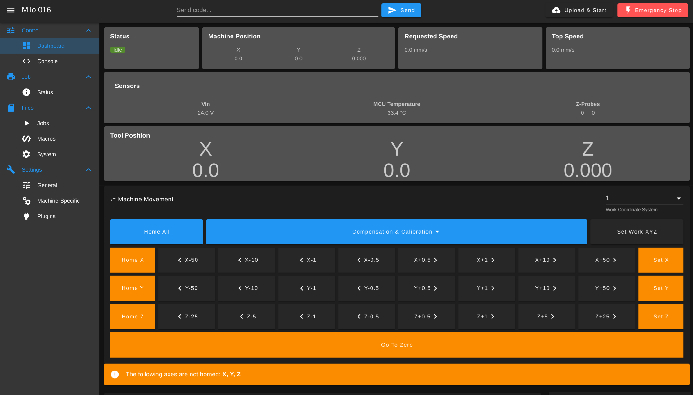
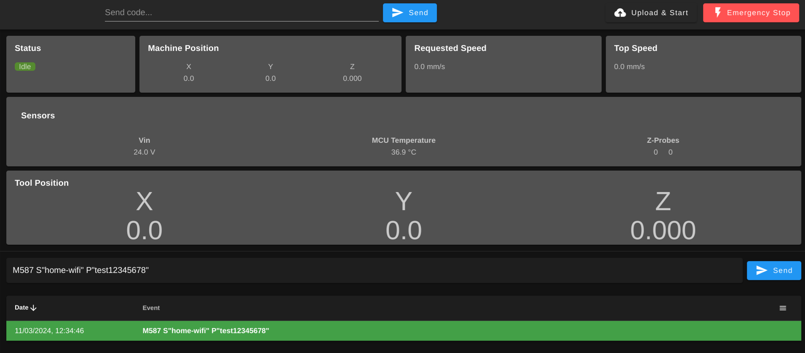
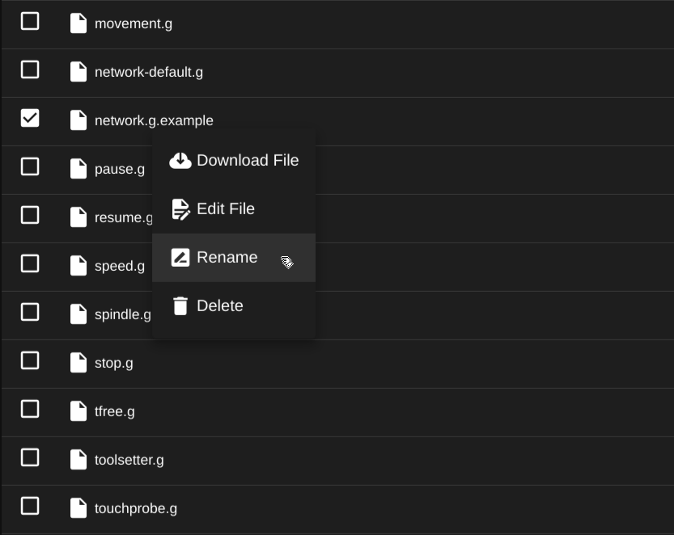

# Installing RRF

*[RRF]: RepRapFirmware
*[DWC]: Duet Web Control
*[UEB]: Universal Electronics Box

This page is for Milo 2.0 and Miley 2.0 builds with a BTT Scylla V1.0 mainboard. It works whether your electronics are in the [Universal Electronics Box](../ueb/index.md) (UEB) or in the electronics bay of a [Casa](../casa/index.md) or [Casita (beta)](https://www.printables.com/model/1829378-casita-the-miley-enclosure-beta) enclosure. It assumes the Scylla is wired as in the [UEB wiring reference (PDF)](https://github.com/MillenniumMachines/Universal-Electronics-Box/blob/main/Millennium%20Universal%20CNC%20wiring%20.pdf).

It takes you from a blank SD card to:

- RepRapFirmware (RRF) installed on the Scylla
- Duet Web Control (DWC), the machine's web interface, on your WiFi network
- a configuration adapted to your Milo 2.0 or Miley 2.0
- the emergency stop, touch probe and toolsetter set up
- endstops, homing and travel limits checked before first use

There is no dedicated 2.0 configuration release yet. This page starts from the Milo 1.5 Scylla release and shows the changes it needs for 2.0.

!!! note "Public Beta"
    The RRF configurations are released as a public beta. As outlined in the repository, we take no responsibility or liability for any loss or damage caused to you or others from the use of this software, which is provided as-is.

!!! info "Coming next: nxt"
    This page sets up MillenniumOS 0.5.x, the current release. Its successor, **nxt** ([MOS-nxt](https://github.com/MillenniumMachines/MOS-nxt)), is in development and not released yet. nxt needs RRF 3.7. This page installs RRF 3.6.1, so moving to nxt later will include a firmware upgrade.

---

## Prepare your SD card

You need a freshly formatted SD card of up to 32GB, class 4 or higher.

- 4GB or smaller: format it as FAT16.
- Larger than 4GB (up to 32GB): format it as FAT32.

---

## Download the configuration release

Open the [RRF-Configs releases](https://github.com/MillenniumMachines/RRF-Configs/releases) page. Under **Assets** of the latest release, download the Scylla zip that matches your motor power supply:

- 48V: `rrf-milo-v1.5-ldo-kit-scylla-v1.0-48v-<version>.zip`
- 24V: `rrf-milo-v1.5-ldo-kit-scylla-v1.0-24v-<version>.zip`

Don't download **Source code**. It isn't laid out for an SD card.

The zip contains RRF 3.6.1 for the Scylla, firmware for its WiFi module, a known-good Milo 1.5 configuration, and MillenniumOS.

---

## Extract it to the SD card

Extract the zip to the root of the SD card. Check that your unzip tool didn't put everything in a folder named after the zip. The root of the card should look like this:

```
firmware/
firmware.bin
gcodes/
macros/
sys/
www/
```

---

## First boot

Eject the SD card, put it in the Scylla, and power the board. It installs RRF, updates the WiFi module, restarts, and then starts a WiFi network called `Milo`.

!!! note "Please be patient"
    The first boot can take 5–10 minutes. When the `Milo` network appears, it's done.

    If it hasn't appeared after 10 minutes, take the SD card out and look at it on your computer. If `firmware.bin` has **not** been renamed to `firmware.cur`, the board wasn't updated. Either way, ask for help on our [Discord](https://discord.gg/ya4UUj7ax2) and say whether the file was renamed.

<!-- HW-CHECK 3: confirm firmware.bin is renamed to firmware.cur on the Scylla after a fresh flash. -->

---

## Connect to Duet Web Control

When the `Milo` network appears, connect to it:

```
SSID:     Milo
Password: millenniummachines
```

Then open [http://192.168.40.1](http://192.168.40.1) in a browser. Note that this is `http`, not `https`.

!!! warning
    Some browsers switch to `https://` on their own. If the page doesn't load, type the full address, `http://192.168.40.1`.

You should see a screen like this. DWC is where you will control the machine from.

{: .shadow-dark}

!!! warning "Cancel the MillenniumOS wizard for now"
    When DWC connects, the MillenniumOS configuration wizard opens. **Cancel it.** The configuration is still set up for a Milo 1.5, so you'll run the wizard later, in [Installing MillenniumOS](../millennium-os/manual/chapters/20_installation.md). It may open again after a restart. Cancel it each time until then.

---

## Join your WiFi network (optional)

By default the machine runs its own `Milo` network. To put it on your WiFi network instead, open the **Console** tab, type this in the `Send code...` box (with your network name and password), and press ENTER:

```gcode
M587 S"your WiFi SSID" P"your WiFi password"
```

A green line means it worked:

{: .shadow-dark}

Next, tell RRF to join that network instead of running its own. Go to **Files → System**, right-click `network.g.example`, choose **Rename**, and rename it to `network.g`:

{: .shadow-dark}

For a static IP address and other network settings, see `M552`, `M553`, `M554` and `M586` in the [Duet3D G-code documentation](https://docs.duet3d.com/User_manual/Reference/Gcodes).

Restart the board (send `M999`). It now joins your network. To find its address, look in your router's list of connected devices, or [connect to the board over USB](https://teamgloomy.github.io/putty.html) with a terminal program and watch for the IP address as it connects.

!!! warning
    If DWC asks to install updates, click **Yes**. This flashes the WiFi module twice: once when you click Yes, and again when the board restarts.

---

## Adapt the configuration to your machine

!!! warning "Do this before homing or moving anything"
    The release is configured for a **Milo 1.5**. Its travel limits, Z drive and homing don't match a 2.0. Make every change in this section before you home or move any axis.

!!! note "Endstop connectors"
    These settings expect the endstops on the Scylla's **X-MIN**, **Y-MAX** and **Z-MAX** connectors, as on page 8 of the [UEB wiring reference (PDF)](https://github.com/MillenniumMachines/Universal-Electronics-Box/blob/main/Millennium%20Universal%20CNC%20wiring%20.pdf). Page 4 of the PDF shows different connectors. Follow page 8.

To edit a file, go to **Files → System** in DWC and click the file. Make the change and click **Save**. When you've made all the changes, restart the board by sending `M999`.

These settings are for the standard TR8×8 leadscrews. Ballscrew (SFK0802) builds need different steps per mm and speeds, which this page doesn't cover. Ask on [Discord](https://discord.gg/ya4UUj7ax2).

### Both machines

**`drives.g`**: change the Z direction and the Z steps per mm. The 2.0 Z motor drives the lead screw directly through a coupler, instead of through the 1.5's 2:1 belt reduction, and it turns the other way. Change these two lines:

```gcode
; was: M569 P2 S0
M569 P2 S1
```

```gcode
; was: M92 X800 Y800 Z1600
M92 X800 Y800 Z800
```

**`fans.g`**: the UEB wiring reference connects the electronics cabinet fan to **AUX1**, but the release drives **AUX0**. Change the fan pin line:

```gcode
; was: M950 F0 C"PA_4" Q500
M950 F0 C"PA_5" Q500
```

!!! note
    The fan works on either AUX0 or AUX1. The pin in `fans.g` must match the output it's plugged into: AUX0 is `PA_4`, AUX1 is `PA_5`. If your fan is on AUX0, leave `fans.g` as it is.

**`user-config.g.example`**: you don't need this file now. If you enable it later, change its steps line to `M92 X800 Y800 Z800` to match `drives.g`.

**`homey.g`**: the 2.0 Y sensor is at the back, so Y homes to **min**, not to max like the 1.5. Replace the whole file with:

```gcode
; homey.g - Lifts Z, then homes Y towards Y0 (min) using existing machine limits.

; Relative positioning in mm and mm/min
G91
G21
G94

; Raise Z towards machine limit as it is already homed
G53 G0 Z{move.axes[2].max}

; Move to Y axis endstop and stop there (first pass).
; Max 1000mm/min with an inductive Y sensor.
G53 G1 H1 Y{-(move.axes[1].max - move.axes[1].min + 5)} F{1000}

; Endstop should now be triggered, verify
if { ! sensors.endstops[1].triggered }
    abort {"Y endstop not triggered after full axis travel. Check that your Y motor is connected and the endstop is working!"}

; Move away from Y endstop
G53 G1 H2 Y{5}

; Repeat Y home at low speed. Do not move further than
; 2 * 5 further than the expected endstop location.
G53 G1 H1 Y{-5*2} F{180}
```

`homez.g` stays as it is. Z still homes upwards.

### Milo 2.0

Milo homes X to **min**, like the 1.5.

**`limits.g`**: replace the whole file with:

```gcode
; limits.g - Configure machine limits and endstops (Milo 2.0)

; Set axis limits - minima
M208 X0 Y0 Z-120 S1

; Set axis limits - maxima
M208 X348 Y210 Z0 S0

; Endstops. LJ8A3-2-Z/AY inductive sensors, so the pins are inverted (!).
; X homes to MIN, Y homes to MIN (Y0), Z homes upwards to MAX (zero).

; X endstop on X-MIN connector, homes to min
M574 X1 S1 P"!PD_11"

; Y endstop on Y-MAX connector, homes to min
M574 Y1 S1 P"!PD_14"

; Z endstop on Z-MAX connector, homes to max
M574 Z2 S1 P"!PD_12"
```

**`homeall.g`**: replace the whole file with:

```gcode
; homeall.g - Homes Z, then homes X and Y (both to min) together using existing machine limits.

; Relative positioning in mm and mm/min
G91
G21
G94

; Home Z first to move spindle out of the way
M98 P"homez.g"

; Move to X and Y axis endstops and stop there (first pass).
; Max 1000mm/min with an inductive Y sensor.
G53 G1 H1 X{-(move.axes[0].max - move.axes[0].min + 5)} Y{-(move.axes[1].max - move.axes[1].min + 5)} F{1000}

; Endstops should now be triggered, verify
if { ! sensors.endstops[0].triggered }
    abort {"X endstop not triggered after full axis travel. Check that your X motor is connected and the endstop is working!"}
if { ! sensors.endstops[1].triggered }
    abort {"Y endstop not triggered after full axis travel. Check that your Y motor is connected and the endstop is working!"}

; Move away from X and Y endstops
G53 G1 H2 X{5} Y{5}

; Repeat X and Y home at low speed. Do not move further than
; 2 * 5 further than the expected endstop locations.
G53 G1 H1 X{-5*2} Y{-5*2} F{180}
```

`homex.g` stays as it is.

### Miley 2.0

Miley's X axis is stationary, so X homes to **max**.

**`limits.g`**: replace the whole file with:

```gcode
; limits.g - Configure machine limits and endstops (Miley 2.0)

; Set axis limits - minima
M208 X0 Y0 Z-120 S1

; Set axis limits - maxima
M208 X308 Y210 Z0 S0

; Endstops. LJ8A3-2-Z/AY inductive sensors, so the pins are inverted (!).
; X homes to MAX, Y homes to MIN (Y0), Z homes upwards to MAX (zero).

; X endstop on X-MIN connector, homes to max
M574 X2 S1 P"!PD_11"

; Y endstop on Y-MAX connector, homes to min
M574 Y1 S1 P"!PD_14"

; Z endstop on Z-MAX connector, homes to max
M574 Z2 S1 P"!PD_12"
```

**`homex.g`**: replace the whole file with:

```gcode
; homex.g - Lifts Z, then homes X towards MAX using existing machine limits.

; Relative positioning in mm and mm/min
G91
G21
G94

; Raise Z towards machine limit as it is already homed
G53 G0 Z{move.axes[2].max}

; Move quickly to X axis endstop and stop there (first pass)
G53 G1 H1 X{move.axes[0].max - move.axes[0].min + 5} F{1800}

; Endstop should now be triggered, verify
if { ! sensors.endstops[0].triggered }
    abort {"X endstop not triggered after full axis travel. Check that your X motor is connected and the endstop is working!"}

; Move away from X endstop
G53 G1 H2 X{-5}

; Repeat X home at low speed. Do not move further than
; 2 * 5 further than the expected endstop location.
G53 G1 H1 X{5*2} F{180}
```

**`homeall.g`**: replace the whole file with:

```gcode
; homeall.g - Homes Z, then homes X (to max) and Y (to min) together using existing machine limits.

; Relative positioning in mm and mm/min
G91
G21
G94

; Home Z first to move spindle out of the way
M98 P"homez.g"

; Move to X and Y axis endstops and stop there (first pass).
; Max 1000mm/min with an inductive Y sensor.
G53 G1 H1 X{move.axes[0].max - move.axes[0].min + 5} Y{-(move.axes[1].max - move.axes[1].min + 5)} F{1000}

; Endstops should now be triggered, verify
if { ! sensors.endstops[0].triggered }
    abort {"X endstop not triggered after full axis travel. Check that your X motor is connected and the endstop is working!"}
if { ! sensors.endstops[1].triggered }
    abort {"Y endstop not triggered after full axis travel. Check that your Y motor is connected and the endstop is working!"}

; Move away from X and Y endstops
G53 G1 H2 X{-5} Y{5}

; Repeat X and Y home at low speed. Do not move further than
; 2 * 5 further than the expected endstop locations.
G53 G1 H1 X{5*2} Y{-5*2} F{180}
```

When you've finished editing, restart the board by sending `M999`.

---

## Emergency stop (Safety Net)

!!! note
    This section assumes the E-stop is wired as in the current [wiring reference (PDF)](https://github.com/MillenniumMachines/Universal-Electronics-Box/blob/main/Millennium%20Universal%20CNC%20wiring%20.pdf): the E-stop signal goes to the Scylla's **X-MAX** connector (PC6) and GND.

The release includes Safety Net, a software emergency stop. When the E-stop is pressed, the Scylla opens its onboard relay and halts. In the wiring reference, that relay is in the contactor circuit (page 3), so the motors and spindle lose power.

!!! warning
    A software emergency stop is **not** a replacement for a hardware emergency stop. Use it **in addition to** the hardware E-stop circuit.

To turn it on:

1. In **Files → System**, rename `estop.g.example` to `estop.g`, and `trigger2.g.example` to `trigger2.g`.
2. In `estop.g`, change the E-stop input pin line to:

    ```gcode
    ; was: M950 J1 C"extin0"
    M950 J1 C"PC_6"
    ```

3. Restart the board (send `M999`).

With Safety Net on, machine power is **off** after every boot. To turn it on, send `M80.9`, check the machine is safe, and press **Activate**. Once MillenniumOS is configured, it asks you this at every boot.

Then test it:

1. With the E-stop released, restart the board. The console shows `E-Stop is not activated, continuing startup`, and the contactor stays off.
2. Send `M80.9` and press **Activate**. The contactor pulls in.
3. Press the E-stop. The board halts and the contactor drops out.
4. Release the E-stop. Machine power must **not** come back on by itself.

If step 1 never shows the message, check the E-stop wiring against the wiring reference before changing anything in `estop.g`.

---

## Touch probe and toolsetter

The release already uses the pins from the wiring reference (page 9):

- **Toolsetter**: `toolsetter.g` is already active, on the toolsetter input (PE7).
- **Touch probe**: rename `touchprobe.g.example` to `touchprobe.g`. It already uses the probe input (PE15).

A 2-pin toolsetter connects to the toolsetter input (PE7) and GND, not to PE15.

The Scylla has jumpers that select PNP or NPN mode and the voltage for the probe and toolsetter inputs (wiring reference, page 5). Set them for your probe and toolsetter. You'll check that both read correctly in the next section.

There are a wide variety of touch probes and toolsetters. Whether a pin needs a `!` depends on whether yours is normally open (NO) or normally closed (NC). If your probe or toolsetter does not work at first it may need the pin inverted, for example, in `touchprobe.g` change `C"PE_15"` to `C"!PE_15"`.

---

## Check inputs and motion before first use

Do these checks in order, with nothing in the spindle and the table clear.

### Inputs

Check every input before you home anything.

**Endstops**: send `M119` in the console. Each axis should show `not stopped`. Then trigger each sensor by hand and send `M119` again: hold a metal object in front of an inductive sensor, or press a microswitch. That axis should now show `at min stop` or `at max stop`. If an axis reads the wrong way round, add or remove the `!` in that axis's `M574` pin in `limits.g`, then restart. A microswitch on Y (instead of an inductive sensor) may need the `!` removed.

**Probe and toolsetter**: send this in the console:

```gcode
echo sensors.probes[0].value[0], sensors.probes[1].value[0]
```

The first value is the touch probe and the second is the toolsetter. Each should read `0` at rest and `1000` while you trigger it by hand. If one reads the wrong way round, add or remove the `!` in the `M558` pin in `touchprobe.g` or `toolsetter.g`, then restart.

**Fan**: check that the cabinet fan runs. If it doesn't, check that the pin in `fans.g` matches the AUX output it's plugged into.

### Homing

Home one axis at a time, Z first, with a hand on the E-stop. Each axis must move **towards its endstop sensor**. If it moves away from the sensor, press the E-stop and check the motor wiring against the wiring reference.

1. Home Z: `G28 Z`. Z moves up.
2. Home X: `G28 X`.
3. Home Y: `G28 Y`.

When all three home correctly, try **Home All** (`G28`).

If you turned on Safety Net, turn machine power on first: send `M80.9` and press **Activate**.

### Travel limits

After homing, check that each axis can reach both ends of its travel without hitting anything. Keep a hand on the E-stop and send these lines one at a time. Each one moves a single axis slowly to one end of its travel. If the axis is already at that end, it doesn't move.

```gcode
G90
G53 G1 X{move.axes[0].min} F600
G53 G1 X{move.axes[0].max} F600
G53 G1 Y{move.axes[1].min} F600
G53 G1 Y{move.axes[1].max} F600
G53 G1 Z{move.axes[2].min} F300
G53 G1 Z{move.axes[2].max} F300
```

If an axis hits a hard stop or anything else before it gets there (you'll hear the motor grind or stall), press the E-stop. Shorten that axis's travel in `limits.g` by 5 mm:

- **X or Y**: lower its maximum in the `M208 ... S0` line, for example `X348` to `X343`.
- **Z**: raise its minimum in the `M208 ... S1` line, for example `Z-120` to `Z-115`.

Restart, home again, and repeat the check until every axis reaches both ends cleanly.

---

## Next: Installing MillenniumOS

Your machine is now running RRF with a 2.0 configuration. The release includes MillenniumOS, but not the newest version. Go to [Installing MillenniumOS](../millennium-os/manual/chapters/20_installation.md) to update it and run the configuration wizard.

MillenniumOS 0.5.x is the current release. Its successor, [nxt](https://github.com/MillenniumMachines/MOS-nxt), is not released yet. When it is, this page will gain an nxt path.
